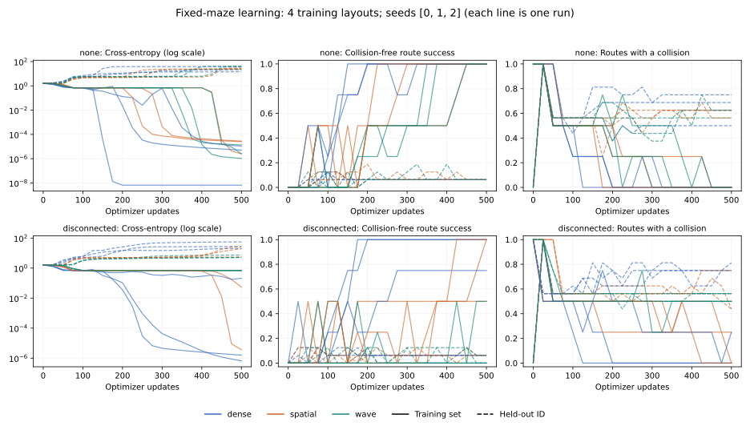
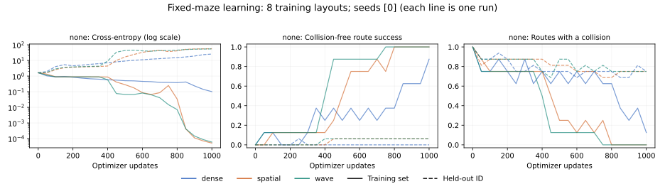

# Fixed-training-set diagnostics — 2026-10-23

All three unmodified variants can memorize the four-maze sanity set: all nine
variant/seed runs reached 100% valid and exact training routes, with no
collisions, by 500 updates. This rules out an absolute inability to fit this
small set. It does **not** establish generalization or a benefit from waves.

The eight-maze follow-up exposes a remaining optimization confound: at 1,000
updates, spatial and wave solved all eight, while dense solved seven and
collided on one. Do not interpret dense's held-out failures as purely a
failure to generalize, and do not rank architectures from one seed.

## What changed

- Whole-training-set and held-out ID evaluation at update zero, every configured
  interval, and the final update. Fixed ordering, eval mode, no gradients, no RNG
  consumption, and restoration of the caller's training mode. CTM's in-place
  decay-parameter clamps are restored after evaluation, so measurement cadence
  does not change optimization.
- Token-weighted cross-entropy (STOP included, `-100` padding excluded), valid
  full-route success, exact canonical BFS sequence, collision rate, token
  accuracy, per-example outcomes/CE, and per-tick metrics. The headline uses
  the final CTM tick, never the best tick chosen with labels. A valid alternate
  route can succeed without matching the BFS sequence. Collision rate is the
  fraction of routes that hit a wall/boundary before their first STOP; stopping
  early is a failure but not a collision.
- A tiny `--overfit` preset and full-batch training; CSV/JSON learning curves;
  optional SVG plotting; parameter counts by module; reversible inference
  interventions and controls that can be trained from the same initialization.
- Production CTM modules, default dense behavior, and original regression
  expectations are unchanged. This remains a generated, open-loop route task
  with an identity backbone, not the original image-maze benchmark.

## Executed protocol

CPU, one PyTorch thread, deterministic algorithms, Python 3.12.14,
PyTorch 2.14.1+cu130, NumPy 2.5.4. CUDA was unavailable. All variants use
64 neurons on an 8x8 latent grid, 8 internal ticks, AdamW at 0.001 with zero
weight decay, and gradient clipping at 1.0. Seeds share data, non-synapse initial
weights and neuron pairings. Spatial/wave share local weights. All updates use
the whole fixed training set; evaluation batches are size 4. Evaluation time
is excluded from recorded training time. Some checks ran concurrently, so
these timings must not be used to rank speed.

The data seed is 1729 throughout. The four-maze set uses 3x3 rooms (7x7 observed
lattice), horizon 32, and route lengths 2, 4, 6, 2 before STOP. It contains only
three distinct route labels: two examples share `right,right,STOP`. It is a
minimal sanity check. The eight-maze set uses 4x4 rooms, horizon 64, and route
lengths 12, 4, 2, 12, 6, 6, 6, 6. Each run also evaluates 16 disjoint ID layouts,
16 larger layouts, and the 90-degree rotations of the ID set. Rotated results
are paired transformations, not an independent sample.

```bash
# Four-maze baseline and a combined bypass control, three paired seeds.
python -m tasks.mazes.spatial_experiment --overfit \
  --seeds 0 1 2 --controls none disconnected --output logs/overfit-verified

# Eight-maze capacity check; one seed, not the 512-maze generalization pilot.
python -m tasks.mazes.spatial_experiment --overfit \
  --train_examples 8 --cells 4 --horizon 64 --steps 1000 --eval_every 50 \
  --seeds 0 --output logs/overfit-eight

# Matched zero-speed training control; retains wave temporal filtering.
python -m tasks.mazes.spatial_experiment --overfit \
  --train_examples 8 --cells 4 --horizon 64 --steps 1000 --eval_every 50 \
  --seeds 0 --wave_speed 0 --output logs/overfit-eight-zero-speed

# Independent repeat of the three four-maze baseline runs.
python -m tasks.mazes.spatial_experiment --overfit \
  --seeds 0 --output logs/overfit-repeat

python -m tasks.mazes.plot_spatial_learning logs/overfit-verified/results.json
```

Use a new output directory each time. `--overfit` sets defaults; explicit flags
win. Without `--overfit`, the original pilot sizes and minibatch sampling remain
the defaults, with the new training-set diagnostics added.

## Metrics and evidence

The gate is CE <= 0.1, 100% valid **and** exact canonical routes, and zero
collisions at each of the last two positive-update evaluations. “First pass”
is the first *observed* checkpoint meeting those numerical conditions; it is
not the exact convergence update or evidence that all later updates pass.

### Four mazes, 500 updates

| Variant | Seed | Training CE | Valid / exact success | Collisions | First pass | Final gate |
| --- | ---: | ---: | ---: | ---: | ---: | --- |
| dense | 0 | 5.09285e-06 | 100% / 100% | 0% | 200 | pass |
| spatial | 0 | 2.8245e-05 | 100% / 100% | 0% | 300 | pass |
| wave | 0 | 1.37617e-05 | 100% / 100% | 0% | 350 | pass |
| dense | 1 | 1.08346e-05 | 100% / 100% | 0% | 250 | pass |
| spatial | 1 | 2.52325e-06 | 100% / 100% | 0% | 450 | pass |
| wave | 1 | 1.05963e-06 | 100% / 100% | 0% | 375 | pass |
| dense | 2 | 6.62274e-09 | 100% / 100% | 0% | 150 | pass |
| spatial | 2 | 2.56945e-05 | 100% / 100% | 0% | 250 | pass |
| wave | 2 | 2.56958e-06 | 100% / 100% | 0% | 450 | pass |



### Eight mazes, 1,000 updates, seed 0

| Variant | Training CE | Valid / exact success | Collisions | ID success | Larger success | Rotated success | Final gate |
| --- | ---: | ---: | ---: | ---: | ---: | ---: | --- |
| dense | 0.10085 | 87.5% / 87.5% | 12.5% | 0.00% | 0.00% | 0.00% | fail |
| spatial | 5.1816e-05 | 100.0% / 100.0% | 0.0% | 6.25% | 0.00% | 0.00% | pass |
| wave | 5.96704e-05 | 100.0% / 100.0% | 0.0% | 6.25% | 0.00% | 0.00% | pass |



The spatial and wave models fit all training labels yet perform poorly on the
16 unseen ID layouts. Their ID CE is about 56 and 54 nats/token, respectively: confident
memorization can coexist with poor held-out performance. These tiny evaluation
sets cannot support precise generalization estimates. Dense has not yet passed
the eight-maze training criterion, so its evaluation also reflects underfitting.

## Can global paths mask the recurrent mechanism?

Yes, they are plausible masking paths, and the controls demonstrate that the
small task can sometimes be solved without the intended recurrent transport.
This is not evidence that every trained model ignores its recurrence.

The action synchronization pools neuron pairs across the sheet into a query.
Global attention reads every observation token, then broadcasts a densely
projected drive to all neurons each tick. Output synchronization also multiplies
potentially distant neuron pairs; a dense projection emits the entire route.
Consequently, the locality of the synapse operator does not imply locality of
the complete computation. The output projection has 10,400 parameters for the
four-maze horizon and 20,800 for the eight-maze horizon. At horizon 64 it accounts
for 51.0% of dense and 61.8% of spatial/wave nominal parameters. These counts
include route slots never supervised by a short example; they are not measures
of effective capacity. Dense also uses GLU plus global LayerNorm, whereas the
local/wave drive uses tanh times sigmoid and no cross-site normalization. This
comparison changes more than the support of the recurrent weights.

The interventions are implemented only in the experiment, with removable
hooks and restored buffers/configuration:

| Control | Removed or changed | What remains |
| --- | --- | --- |
| `no-recurrence` | Activated-state input to synapses is zero; wave displacement/velocity reset every tick | State-dependent global attention, per-neuron temporal history, synchronization accumulators, global readout |
| `fixed-query` | Query projection output is replaced by zero | Learned attention query bias, global observation attention, recurrent synapses, readout |
| `self-pairs` | Output products (i,j) become (i,i), preserving feature count | Dense output mixing, global action/attention path, synapses |
| `disconnected` | All three interventions above | Global static-query observation attention and broadcast, per-neuron temporal history, self-synchronization and dense readout; dense normalization also remains |
| `zero-speed` | Wave Laplacian coupling only | Local learned recurrent weights and driven damped oscillator memory |

The combined control retains temporal processing and global input/output
operations. It is **not** a fully local or memory-free model. Inference lesions
measure dependence of a particular fitted solution under a distribution shift;
retrained controls test whether a solution exists without that path.

### Retrained combined control, four mazes, 500 updates

| Variant | Seed | Training CE | Valid / exact success | Collisions | Final gate |
| --- | ---: | ---: | ---: | ---: | --- |
| dense | 0 | 1.58283e-06 | 100% / 100% | 0% | pass |
| spatial | 0 | 0.691192 | 50% / 50% | 25% | fail |
| wave | 0 | 0.693197 | 0% / 0% | 50% | fail |
| dense | 1 | 6.62273e-07 | 100% / 100% | 0% | pass |
| spatial | 1 | 0.0543037 | 100% / 100% | 0% | fail |
| wave | 1 | 0.693148 | 0% / 0% | 50% | fail |
| dense | 2 | 0.209892 | 75% / 75% | 25% | fail |
| spatial | 2 | 3.62262e-06 | 100% / 100% | 0% | pass |
| wave | 2 | 0.685591 | 50% / 50% | 50% | fail |

Dense passes the stability gate for two of three seeds, spatial for one, wave
for none. Spatial seed 1 first reaches the numerical criterion at update 500,
so it has perfect final routes but lacks a second confirming checkpoint.
These are fixed-budget optimization outcomes, not impossibility results.

### Inference interventions on eight-maze checkpoints (seed 0)

| Intervention | Dense training success | Spatial training success | Wave training success |
| --- | ---: | ---: | ---: |
| none | 87.5% | 100.0% | 100.0% |
| no-recurrence | 25.0% | 62.5% | 12.5% |
| fixed-query | 12.5% | 12.5% | 12.5% |
| self-pairs | 12.5% | 0.0% | 0.0% |
| disconnected | 12.5% | 0.0% | 0.0% |
| zero-speed | not applicable | not applicable | 12.5% |

On the four-maze seed-0 checkpoints, removing the spatial synapse recurrent
input preserves 100% training success, and setting wave speed to zero also
preserves 100%. On eight mazes, the fitted wave model falls to 12.5% when
speed is set to zero. That larger-set dependence does not establish an
advantage: the retrained zero-speed control also fits all eight.

### Zero-speed training, eight mazes, 1,000 updates, seed 0

| Wave setting | Training CE | Valid / exact success | Collisions | First pass | ID success |
| --- | ---: | ---: | ---: | ---: | ---: |
| speed 0.5 | 5.96704e-05 | 100% / 100% | 0% | 750 | 6.25% |
| speed 0 | 2.6022e-05 | 100% / 100% | 0% | 550 | 6.25% |

Both pass the final stability gate. The zero-speed condition reaches the
criterion earlier in this seed, while both have 6.25% ID success, 0% larger
success and 0% rotated success. Thus this experiment supplies no evidence of
a wave-propagation learning/generalization benefit. It does not establish that
zero speed is better across seeds or tasks. Dense/spatial runs are repeated
unchanged by this flag and match exactly, providing another reproducibility
check. Zero speed still permits spatial communication through local weights.

## Prerequisites for the larger experiment

1. **Met:** oracle route/metric tests, deterministic evaluator, finite updates,
   reproducible checkpoint reloads, and four-maze capacity for all three models
   across seeds 0, 1, 2. A fresh seed-0 repeat reproduced all losses, learning
   curves, final predictive metrics, interventions and model tensors exactly.
2. **Not met:** solve a more diverse 8–16-maze set across all paired seeds under
   a fixed declared budget, with CE <= 0.1, exact and valid route success 100%,
   and zero collisions at the last two measurements. Dense's 7/8 result fails
   even the current single-seed eight-maze check. Increase the optimization
   budget or tune LR/tick count on training/validation data, applying comparable
   selection budgets to every variant. A budget-limited failure does not prove
   insufficient model capacity. Do not silently discard failed seeds.
3. **Not met for a mechanism claim:** repeat the eight-maze zero-speed and
   individual attention/readout controls across seeds; compare matched drive
   scales, pointwise nonlinearities/normalization, output capacity, and
   parameter/compute budgets. If the benefit survives, test a task that requires
   transport with localized input access and readout. Global broadcast remains
   available in the present pilot. Specify these architectural restrictions
   explicitly before attributing gains to local propagation.
4. **Then scale:** run the declared 512-train/128-test, 1,000-update, three-seed,
   16-tick pilot while retaining full training-set curves. Report per-seed train
   and held-out performance jointly. If training remains poor, treat that run
   as under-optimization; it cannot identify a generalization failure alone.
   If tuning uses the currently observed ID results, reserve a fresh final test
   split. Evaluate wave versus spatial and zero-speed controls with paired
   seeds and uncertainty before making a generalization claim.

The 512-maze multi-seed experiment was **not run**. Neither were multi-seed
8–16-maze tuning/controls, matched-normalization/capacity experiments, localized
attention/readout redesign, original image-maze training, or GPU/AMP/compile/DDP
validation. Those require additional experiment budget; no benefit or hardware
compatibility is claimed from code availability.

## Validation and retained artifacts

- 180 tests passed in the full combined invocation; the RL golden test initially
  errored during setup because `umap-learn` was missing. After installing it,
  that exact test passed. Thus all **181** tests were exercised successfully:
  138 original regressions, 34 from PR #1 and 9 new diagnostic tests (counting
  parametrized cases). No golden expectations were changed.
- The new cases test token weighting/padding, alternate routes, STOP/collisions,
  ordered repeatable evaluation with dropout, state restoration including on
  errors, intervention semantics/cleanup, gates/preset overrides, controlled
  checkpoint reload, and bit-for-bit invariant training across evaluation
  cadences. They do not assert fragile training convergence in unit tests.
- Compilation, `git diff --check`, plot generation and visual inspection passed.
- The runner's recorded source hashes match the delivered Python sources.
  The recorded parent commit plus `working_tree_dirty=true` is intentional:
  experiments ran before the diagnostic changes were committed; hashes identify
  the precise experiment implementation. Earlier development runs are not used
  as final evidence.

Evidence is in [experiments/spatial-overfit-20261023](experiments/spatial-overfit-20261023):
full raw results JSON, training curves CSV, exact dataset NPZ arrays and rendered
SVGs for the four-maze, eight-maze and eight-maze zero-speed runs; repeat results,
test logs, dependency versions and a SHA-256 manifest. Result `trace_file` fields
name local runtime outputs; large activation traces and model/optimizer files
are not versioned. Running the commands regenerates those `.npz`/`.pt` files.
For controlled checkpoints, reapply `mechanism_control(model, checkpoint['control'])`
when evaluating, as shown in [the experiment guide](spatial_synapses.md).

CSV line endings and generated text whitespace are normalized for version control;
numeric values are unchanged. The manifest hashes the retained files.
